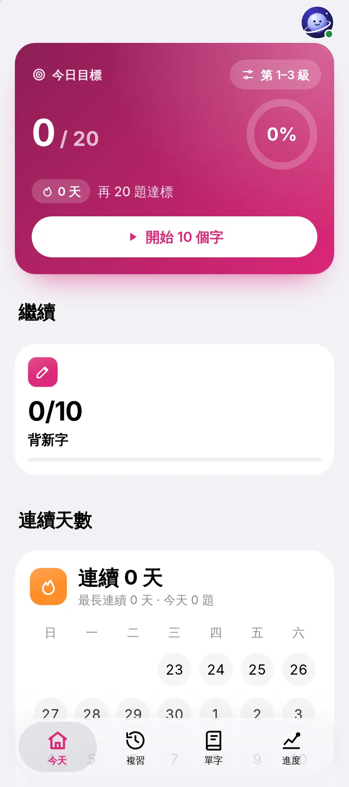
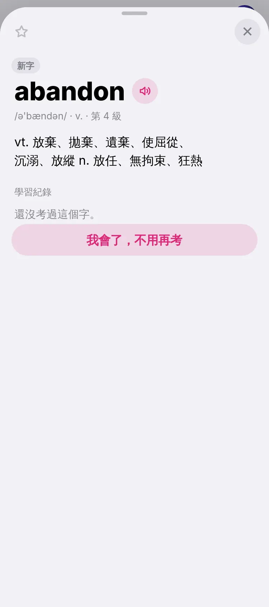
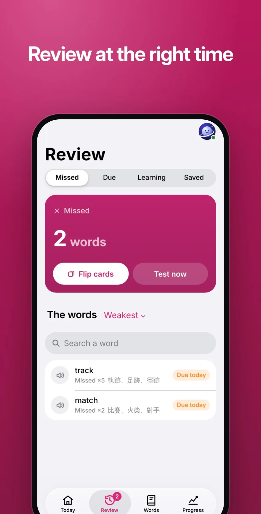
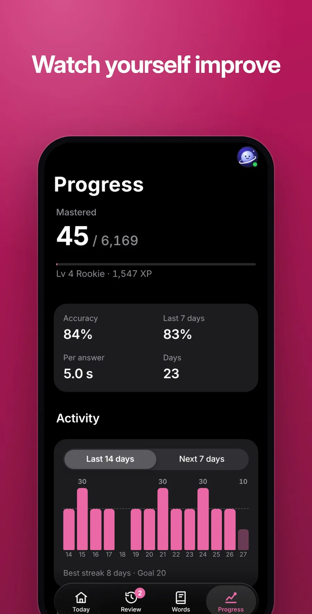
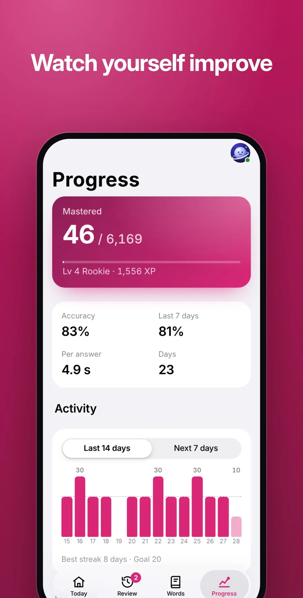
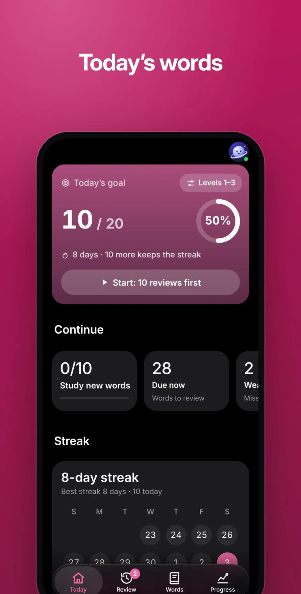

<p align="center">
  
</p>

<h1 align="center">Orbit Words</h1>

<p align="center">
  <b>Words that stay.</b><br>
  <a href="https://orbit.jaypengx.com/words/"><b>orbit.jaypengx.com/words</b></a>
</p>

<p align="center">
      
</p>

English vocabulary that sticks: the full 大考中心 list, levels 1 to 6 (6,169 words), each with a recorded voice. Part of **Orbit**, a family of phone apps for life in Taiwan that share one sign-in, the Orbit Pass. See them all at [orbit.jaypengx.com](https://orbit.jaypengx.com/pass/).

<p align="center">
  
  
  
</p>

<p align="center">
  
  
  
</p>

## Features

- **The whole 大考中心 list:** levels 1 to 6, 6,169 words, each recorded in a natural voice.
- **Today:** a daily goal of 20 and a streak; new words as cards, the weak words, a word of the day. Pick 10, 20 or 30 words, the levels, the way to learn and the sound speed.
- **Hard on purpose:** the wrong options are the likeliest mix-ups (spelt alike, close in meaning, or words you already confused).
- **A quick check first:** a word you know at a glance goes away for weeks; one you miss is learnt.
- **Eight ways to practise, picked on the home screen:** smart (by memory), meaning, word, by ear, dictation, sentences (the word's example with a blank), letters and fill-in.
- **Review:** wrong answers, what's due, what you're learning and your saved words, as flash cards and then a test.
- **A word's page,** from a dictionary written for Taiwan students (meanings from Wiktionary in Taiwan wording, the main sense first): sound, KK, the senses a student needs first, an example sentence with its Chinese, the word's forms, what you mixed it up with, your misspellings and the chance you still know it.
- **拼字比賽:** a timed paper of spelling by ear (each word said twice) then multiple choice, in three sizes: 20+20, 50+50 (40 minutes, the national contest's) and 50+100.
- **Progress:** level and points, accuracy, the last 14 days, each level, and the words you forget most.
- **Fully offline**, synced between devices through the Orbit Pass.

## Tech stack

| Layer | What |
| --- | --- |
| App | Plain JavaScript (ES modules), HTML and CSS; no framework, no build step, no dependencies |
| Platform | Installable web app; the service worker keeps every word and recording, so it works with no network |
| Shared | Look, Orbit Pass sync (`pass-sync.mjs`) and the 20:00 streak notice from the kit in [Orbit-Core](https://github.com/JayPengX/Orbit-Core) |
| Memory model | FSRS-5 (stability and difficulty); 10 days' stability counts as mastered |
| Data | `data/words.json` (the list, its senses and KK), `data/more.json` (examples and forms), `data/hints.json` (mnemonics and mix-ups, written once offline), `data/audio/` (one recording per word) |
| Tests | `node --test`, including merging progress across devices |

## How it works

- **Progress is a small compressed row per word** (`z3:` + gzip), saved on the phone at every answer and merged with the Pass's copy before anything is written. A copy that can't be read is never written over; the newer settings win a merge.
- **Rounds** (`lib/words.mjs`) put the new words most likely to be missed first, then schedule each by its FSRS stability.
- **Nothing generated live:** hints and mix-ups are files, and recorded voices always win over the device's.

Details and the decisions still in force: **[MAP.md](MAP.md)**.

## Project structure

```
public/
├── index.html, app.js, shell.js, ui.js, audio.js   start, saving, tabs, drawing, sound
├── views/            each tab, the round, flash cards, the word sheet
├── lib/
│   ├── words.mjs     memory model, rounds, questions, wrong options
│   ├── copy.mjs      the saved payload: encode, decode, merge
│   └── review.mjs, practice.mjs   review lists; points and streak
├── data/             words.json, more.json, hints.json, audio/
└── sw.js
tests/                node --test
MAP.md                how it works
```

## Getting started

The app loads the shared kit from a sibling folder, so clone this repo next to [Orbit-Core](https://github.com/JayPengX/Orbit-Core):

```bash
git clone https://github.com/JayPengX/Orbit-Core.git
git clone https://github.com/JayPengX/Orbit-Words.git
cd Orbit-Words
```

Requirements: Node.js 22 or newer. There is nothing to install: no framework, no `node_modules`.

```bash
npm test   # links ../Orbit-Core/kit as .kit, then runs node --test
```

See it on a phone-sized screen, signed in with a made-up wallet and real data (needs Playwright):

```bash
# a screenshot, saved in /tmp/orbit-preview
node ../Orbit-Core/tools/preview.mjs words --live --width 375
# serve it, then open http://localhost:8123/Orbit-Words/
node ../Orbit-Core/tools/preview.mjs words --live --serve --port 8123
```

`--dark`, `--lang en`, `--webkit` (Safari's engine) and the other flags are listed in [Orbit-Core/tools/README.md](https://github.com/JayPengX/Orbit-Core/blob/main/tools/README.md).

Missing recordings: `python3 ../Orbit-Core/tools/word-audio.py`.

## Deploying

Push to `main`. GitHub Actions runs the tests, stamps every file with its content hash (so a phone downloads only what changed) and publishes `public/` to GitHub Pages; the site Worker serves it at its orbit.jaypengx.com address. There are no pull requests or release branches.

## Part of Orbit

| App | What it is |
| --- | --- |
| [Orbit Sports](https://github.com/JayPengX/Orbit-Sports) | Every game you can watch in Taiwan, live |
| [Orbit Transit](https://github.com/JayPengX/Orbit-Transit) | Bus, train, metro and YouBike, planned and navigated |
| [Orbit Weather](https://github.com/JayPengX/Orbit-Weather) | One clear forecast, to the township |
| [Orbit Words](https://github.com/JayPengX/Orbit-Words) | English vocabulary that stays |
| [Orbit Securities](https://github.com/JayPengX/Orbit-Securities) | A Taiwan broker on play money |
| [Orbit Class](https://github.com/JayPengX/Orbit-Class) | Today's classes at a glance |
| [Orbit Beats](https://github.com/JayPengX/Orbit-Beats) | Endless music and your own beats |
| [Orbit Law](https://github.com/JayPengX/Orbit-Law) | Laws, rulings and bills, linked |
| [Orbit Money](https://github.com/JayPengX/Orbit-Money) | Your own books |
| [Orbit-Core](https://github.com/JayPengX/Orbit-Core) | The kit, the Orbit Pass and the Workers behind them all |

How it was all built, in pictures and numbers: [jaypengx.com/showcase](https://jaypengx.com/showcase/).

## Credits

Meanings and pronunciations draw on [Wiktionary](https://en.wiktionary.org) (via [kaikki.org](https://kaikki.org), CC BY-SA 4.0); example sentences come from [Tatoeba](https://tatoeba.org) (CC BY 2.0 FR). The dictionary files `public/data/words.json`'s meanings and `public/data/more.json` are shared under CC BY-SA 4.0.
